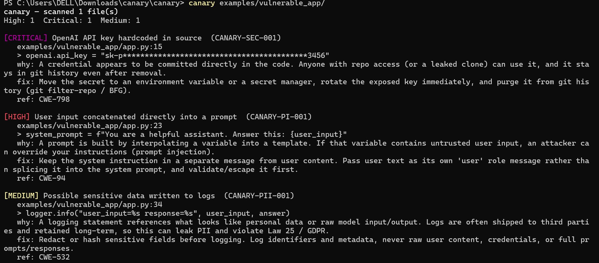
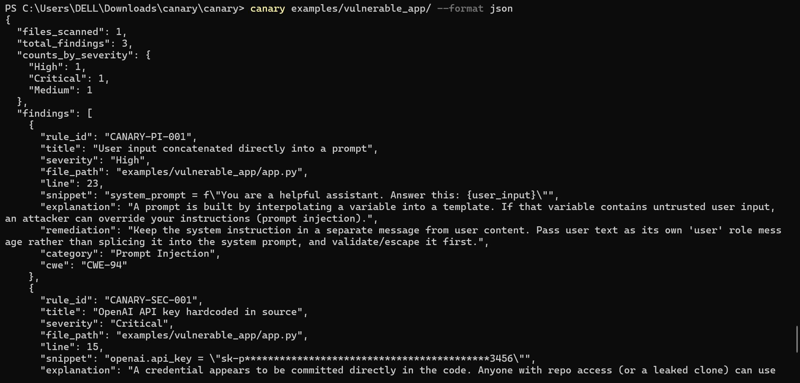
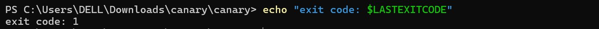

# canary

A static security scanner for **LLM and AI-agent applications**.

Traditional linters and SAST tools were built for a world before language
models. They don't know what a prompt is, they can't tell a guardrail from a
regular function call, and they have no concept of "untrusted input reaching
a model." `canary` is built for exactly that gap.

It scans a codebase and flags the failure modes specific to AI features:

| Category | What it catches | Example rule |
|---|---|---|
| **Prompt injection** | Untrusted input spliced straight into a prompt | `CANARY-PI-001` |
| **Exposed secrets** | OpenAI / Anthropic / Google / AWS keys committed in source | `CANARY-SEC-001` |
| **Missing guardrails** | Model calls with no output validation or moderation | `CANARY-GR-001` |
| **Sensitive data logging** | Raw user input, prompts, or PII written to logs | `CANARY-PII-001` |

Zero runtime dependencies — it's pure standard-library Python, so it drops
into any CI pipeline without dragging a tree of packages behind it.

## Install

```bash
pip install canary-scan
```

Or from source:

```bash
git clone https://github.com/jcedrik/canary.git
cd canary
pip install -e .
```

## Usage

Scan a directory:

```bash
canary ./my-app
```

Scan a single file, output JSON for CI:

```bash
canary app.py --format json
```

Only report medium-and-up, fail the build on anything high or worse:

```bash
canary ./my-app --min medium --fail-on high
```

### Options

| Flag | Default | Description |
|---|---|---|
| `--format` | `text` | `text` (human) or `json` (machine / CI) |
| `--min` | `info` | Only report findings at or above this severity |
| `--fail-on` | `high` | Exit non-zero if any finding meets this severity |

### Exit codes

| Code | Meaning |
|---|---|
| `0` | No findings at or above `--fail-on` |
| `1` | Findings at or above `--fail-on` were present |
| `2` | Usage or runtime error |

## Example output

Running against the bundled vulnerable example:



Machine-readable JSON for CI consumption (`--format json`):



The scan exits non-zero when findings meet the `--fail-on` threshold, so it gates a build:



## Use in CI

GitHub Actions:

```yaml
- name: Security scan
  run: |
    pip install canary-scan
    canary . --fail-on high
```

The non-zero exit on findings fails the job, so insecure AI code never
reaches `main`.

## How it works

`canary` runs a set of independent **detectors** over each source file.
Python files are parsed into an AST for accurate prompt-injection detection;
other languages use targeted pattern matching. Each detector is conservative
by design — it favors a quiet scan over crying wolf, because a scanner that
floods you with false positives is a scanner you uninstall.

Findings carry a stable rule ID, a CWE reference, a plain-language
explanation, and a concrete fix.

## Roadmap

- [ ] `--baseline` to suppress known/accepted findings
- [ ] Inline `# canary: ignore RULE-ID` suppression comments
- [ ] SARIF output for GitHub code-scanning integration
- [ ] Detectors for unsafe tool/function-calling exposure in agents
- [ ] Taint tracking across functions (not just within a statement)

## Why I built it

I work on LLM-powered internal agents and hold Security+, AZ-500, and AWS
Solutions Architect certifications. The same hardening I do by hand — keeping
user input out of system prompts, validating model output, keeping secrets
and PII out of code and logs — is mechanical enough to automate. `canary` is
that automation, built from scratch and open to anyone shipping AI features.

## License

MIT — see [LICENSE](LICENSE).
