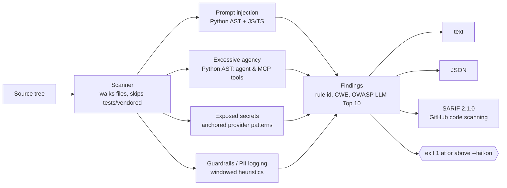

# canary

[](https://github.com/jcedrik/canary/actions/workflows/ci.yml)
[](https://pypi.org/project/canary-sast/)
[](https://pypi.org/project/canary-sast/)
[](LICENSE)


Static security scanner for **LLM and AI-agent code**. Reads your source, never
runs a model, finds the failure modes classic SAST does not know about, and
fails the build.

```
canary ./my-app --fail-on high
```



## What it catches

| Rule | Category | OWASP LLM Top 10 | Severity | How |
|---|---|---|---|---|
| `CANARY-PI-001` | Untrusted input spliced into a prompt (Python) | LLM01 Prompt Injection | High | AST: prompt-like target, input-like interpolation |
| `CANARY-PI-002` | Same, in JS/TS template literals | LLM01 | Medium | pattern |
| `CANARY-EA-001` | Agent/MCP tool runs shell, `eval`, `exec` on model-controlled args | LLM06 Excessive Agency | High | AST: decorated or registered tool functions |
| `CANARY-EA-002` | Agent/MCP tool writes files or raw SQL without validation | LLM06 | Medium | AST |
| `CANARY-SEC-001..004` | OpenAI / Anthropic / Google / AWS keys in source | LLM02 Sensitive Information Disclosure | Critical | anchored patterns, value redacted in the report |
| `CANARY-SEC-005` | Generic `api_key = "..."` assignment | LLM02 | High | pattern |
| `CANARY-PII-001` | Personal data or credentials written to logs | LLM02 | Medium | identifiers inside the log call |
| `CANARY-GR-001` | Model call with no visible output validation | LLM05 Improper Output Handling | Low (advisory) | windowed heuristic |

Every finding carries a stable rule id, a CWE, the OWASP LLM Top 10 category,
a plain-language *why* and a concrete *fix*.

## Numbers

Measured on ten public LLM application repositories (Google ADK samples,
openai-agents-python, anthropic-cookbook, vanna, crewAI examples,
chat-langchain, Chainlit cookbook, pydantic-ai, mem0, open_deep_research),
4,525 files, every reviewed finding read in context. Full tables and the
per-finding labels are in [`bench/RESULTS.md`](bench/RESULTS.md) and
[`bench/results/labels.csv`](bench/results/labels.csv).

| | v0.1.0 | v0.2.0 |
|---|---:|---:|
| Findings on the same 10 repos | 2,231 | 222 |
| `CANARY-PI-001` precision (reviewed) | not measured | 31 / 33 = **94 %** |
| `CANARY-PII-001` precision (reviewed) | not measured | 2 / 3 |
| `CANARY-GR-001` precision (sample of 37) | not measured | 9 / 37 = 24 %, hence downgraded to Low |
| `CANARY-SEC-005` reviewed true positives | not measured | 0 / 2 |
| Throughput | | ~140 files/s, 33 s for all ten repos |

What this says, honestly: the prompt-injection and excessive-agency rules are
the ones to gate a build on. The guardrail rule is a hint. The generic secret
rule finds mostly fixtures; the provider-specific ones (`SEC-001..004`) are
the ones that matter and they produced zero false positives after anchoring.
Recall is not measured because no ground truth exists for these repositories.

## Install

```bash
pip install canary-sast
```

Or from source:

```bash
git clone https://github.com/jcedrik/canary.git
cd canary
pip install -e .
```

The CLI is `canary`. Zero runtime dependencies, standard library only.

## Usage

```bash
canary ./my-app                       # human-readable report
canary ./my-app --format json         # machine-readable
canary ./my-app --format sarif -o canary.sarif   # GitHub code scanning
canary ./my-app --min medium --fail-on high      # gate the build
canary ./my-app --baseline accepted.json         # fail only on new findings
canary ./my-app --include-tests                  # also scan tests/ and fixtures
```

| Flag | Default | Description |
|---|---|---|
| `--format` | `text` | `text`, `json` or `sarif` |
| `-o`, `--output` | stdout | write the report to a file |
| `--min` | `info` | only report findings at or above this severity |
| `--fail-on` | `high` | exit 1 if any finding meets this severity |
| `--baseline` | none | JSON report whose findings are considered accepted |
| `--include-tests` | off | scan test dirs, fixtures, cassettes and docs too |

Exit codes: `0` clean, `1` findings at or above `--fail-on`, `2` usage error.

Inline suppression, when a finding is accepted on purpose:

```python
prompt = f"Summarize: {document}"  # canary: ignore CANARY-PI-001
```

## Use in CI

As a reusable Action (scans, uploads SARIF to the Security tab, then gates):

```yaml
permissions:
  contents: read
  security-events: write

steps:
  - uses: actions/checkout@v4
  - uses: jcedrik/canary@v0.2
    with:
      path: .
      fail-on: high
```

Or by hand:

```yaml
- run: pip install canary-sast && canary . --format sarif -o canary.sarif || true
- uses: github/codeql-action/upload-sarif@v3
  with: { sarif_file: canary.sarif }
- run: canary . --fail-on high
```

## Example

The bundled [`examples/vulnerable_app`](examples/vulnerable_app/app.py) trips
every rule family:

```
canary — scanned 1 file(s)
High: 2  Critical: 1  Medium: 1  Low: 1
OWASP LLM Top 10: LLM01: 1  LLM02: 2  LLM05: 1  LLM06: 1

[CRITICAL] OpenAI API key hardcoded in source  (CANARY-SEC-001)
   examples/vulnerable_app/app.py:15
   > openai.api_key = "sk-p******************************************3456"
   ...
[HIGH] Agent tool executes shell or eval with model-controlled input  (CANARY-EA-001)
   examples/vulnerable_app/app.py:49
   > return subprocess.check_output(cmd, shell=True).decode()
   why: Tool `run_command` calls `subprocess.check_output`. The model can call this tool with arbitrary arguments ...
   fix: Never pass model output to a shell. Use an allowlist of commands ...
   ref: CWE-78 / LLM06
```


## Where canary sits

[garak](https://github.com/NVIDIA/garak) and [promptfoo](https://github.com/promptfoo/promptfoo)
are **dynamic**: they attack a running model with adversarial prompts.
[llm-guard](https://github.com/protectai/llm-guard) and NeMo Guardrails are
**runtime**: they filter inputs and outputs in production. canary is
**static**: it reads the source before anything runs, in CI, in under a
second for most repos. They are complementary. canary tells you that a tool
function hands `cmd` to a shell; garak tells you whether your deployed model
can be talked into calling it.

## How it works

The scanner walks the tree once, skipping vendored code and (by default) test
directories, and hands each file to every detector. Python detectors parse
the file into an AST, so `CANARY-PI-001` knows the difference between
`prompt = f"...{user_input}"` and `prompt = "..."`, and `CANARY-EA-001` knows
which functions are decorated as tools or passed into `tools=[...]`. JS/TS
and other languages use anchored patterns. Every detector is wrapped so a bug
in one cannot abort the scan.

Design rule, learned from the benchmark: a detector that is wrong three times
out of four gets demoted, not deleted. `GR-001` is Low for that reason.

## Benchmark

```bash
pip install -e .
python bench/run_benchmark.py      # shallow-clones bench/repos.txt, scans, writes bench/results/
# review bench/results/labels.csv: set label = TP / FP per row
python bench/summarize.py          # regenerates bench/RESULTS.md
```

## Roadmap

- [x] SARIF output and GitHub code scanning integration (0.2)
- [x] Inline `# canary: ignore` suppression (0.2)
- [x] `--baseline` for accepted findings (0.2)
- [x] Detectors for agent tool exposure (0.2)
- [ ] KQL export so findings land in Microsoft Sentinel
- [ ] MCP server so coding agents can scan as they write
- [ ] Taint tracking across function boundaries
- [ ] Detector for system prompt leakage (LLM07)

## Why I built it

I spent a summer building LLM agents inside a large enterprise, with guardrails
on model input and output and a hard line on PII. The hardening I kept doing by
hand (user text out of system prompts, model output validated, keys and PII
out of code and logs, tools scoped to the minimum) is mechanical enough to
automate. canary is that automation, measured against real code so the
numbers above mean something.

## License

MIT, see [LICENSE](LICENSE).
